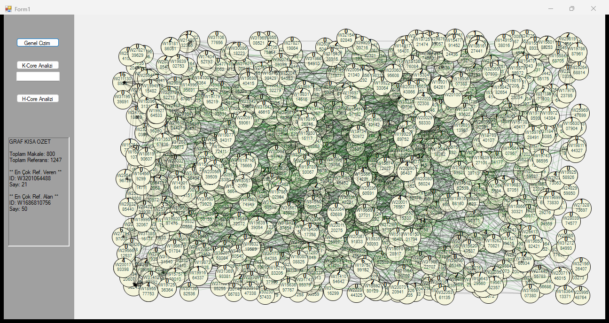
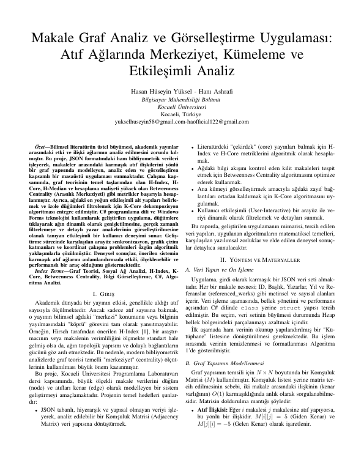
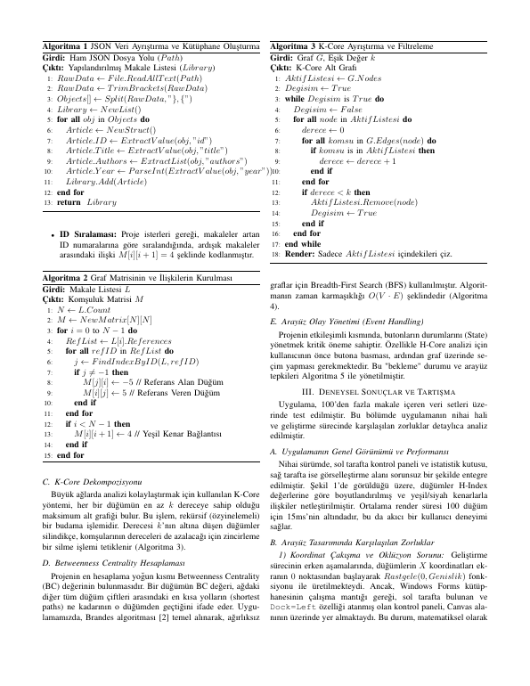
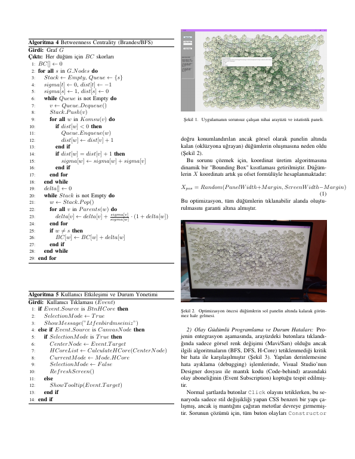
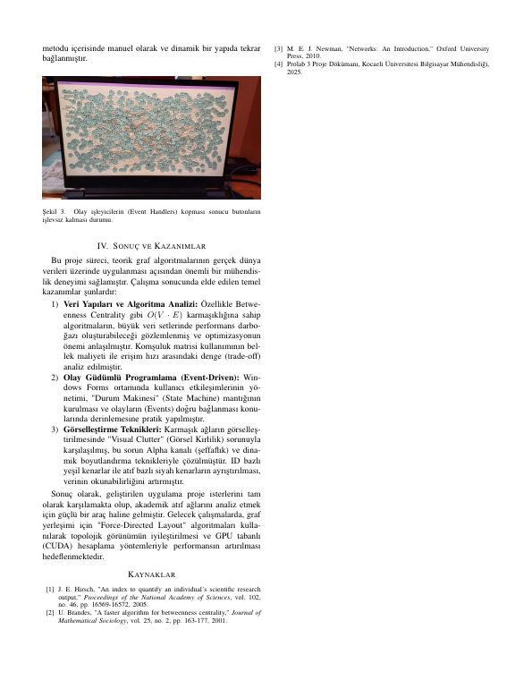

# Citation graph analysis and visualisation (C#, WinForms)

A desktop app that loads a citation network of papers and analyses it.

## Context

Coursework for the Programming Laboratory (Prolab) course, Computer Engineering, Kocaeli University - Fall 2025, project 3.

## What it does

- Builds a graph of papers and citations from the input data
- Computes centrality measures and clustering
- Interactive visual exploration in a Windows Forms window

## Build / run

Open `ProlabProje3.sln` in Visual Studio (.NET Framework) and run.

## Report

The full project report (PDF) is in `docs/report.pdf`.

## Notes

No API keys, tokens or credentials are used or stored in this repository.

## Screenshot

The app reads `1txt.txt` (an OpenAlex export of 800 papers supplied for the course) from its working folder; place it next to the exe.

## Report pages

Full report: [docs/report.pdf](docs/report.pdf)

